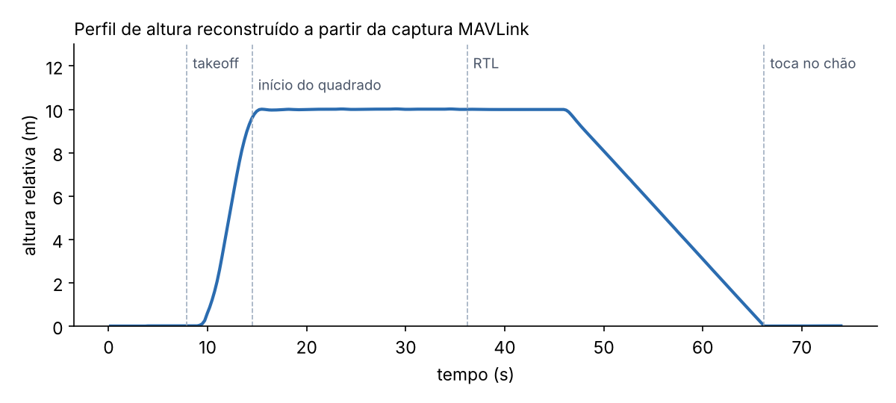
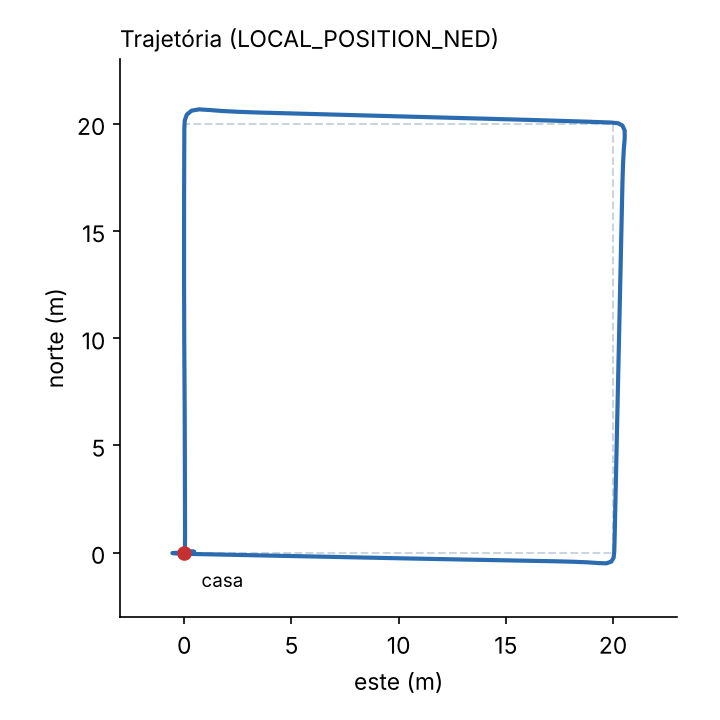

# 01 · Primeiro voo autónomo e análise do tráfego MAVLink

Script em Python que se liga ao ArduPilot SITL por MAVLink, descola até 10 m, faz um quadrado de 20 m e regressa a casa. Depois capturei o tráfego no Wireshark e escrevi um segundo script que reconstrói o voo só a partir dos pacotes.

## Ficheiros

| Ficheiro | O que faz |
|---|---|
| `primeiro_voo.py` | Voo autónomo: GUIDED, arm, takeoff, quadrado em coordenadas NED, RTL |
| `analisar_voo.py` | Lê um `.pcapng` e mostra a linha temporal do voo, os comandos enviados, a telemetria e observações de segurança |
| `exercicios/` | Variações que fui fazendo (ver [EXERCICIOS.md](EXERCICIOS.md)) |

## Como correr

```bash
# terminal 1: simulador
cd ~/UAV/ferramentas/ardupilot
Tools/autotest/sim_vehicle.py -v ArduCopter --out 127.0.0.1:14551

# terminal 2: voo
pip3 install pymavlink dpkt
python3 primeiro_voo.py

# depois de gravar uma captura no Wireshark (interface lo0)
python3 analisar_voo.py Voo.pcapng
```

O QGroundControl liga-se sozinho pela porta UDP 14550. O script usa a 14551.

## Resultados

Perfil de altura e trajetória, extraídos das mensagens `GLOBAL_POSITION_INT` e `LOCAL_POSITION_NED` da captura:





| Medida | Valor |
|---|---|
| Tempo no ar | 55 s |
| Altura de cruzeiro | 10,0 m (erro de ~2 cm) |
| Tempo médio por lado (20 m) | ~5,7 s |
| Velocidade média por lado | 3,2 a 3,8 m/s (pico de 6,5 m/s) |
| Velocidade na aterragem | 0,5 m/s |
| Telemetria por saída do MAVProxy | ~112 mensagens/s, ~31,5 kbit/s |

## O que a captura mostrou

- **Nenhuma mensagem vinha assinada.** O drone aceitou comandos de qualquer processo que enviasse para a porta, sem verificar a origem.
- **O script e o QGroundControl usavam o mesmo sysid (255).** Do lado do drone, não há forma de distinguir as duas estações de solo.
- **Um `REQUEST_DATA_STREAM` do script mudou a telemetria para todos os clientes**, incluindo o QGroundControl.
- **44% de overhead.** Cada mensagem MAVLink tinha em média 35 bytes, e o IP e o UDP acrescentam mais 28.
- **Saída duplicada no MAVProxy:** por engano, ativei duas saídas para a mesma porta, e cada comando chegou duas vezes ao drone. Os números de sequência e os ACK repetidos na captura permitiram perceber o que se passava.
- **No loopback não há perdas** (0 falhas na sequência). Num rádio real, este campo passa a ser a forma de medir a qualidade do link.

## O que aprendi

- As coordenadas locais são NED (norte, este, para baixo): subir 10 m é `z = -10`.
- O home (para onde o RTL volta) e a origem do EKF (referência do `LOCAL_POSITION_NED`) podem não coincidir. Depois de aterrar com LAND noutro ponto, o quadrado seguinte saiu deslocado.
- O ArduCopter desarma sozinho se não descolar em ~10 s depois de armar.
- O RTL não sobe até à `RTL_ALT` quando o drone já está por cima de casa (`RTL_CONE_SLOPE`).
- A velocidade média num lado curto fica bem abaixo da máxima, porque grande parte do tempo é passada a acelerar e a travar.
